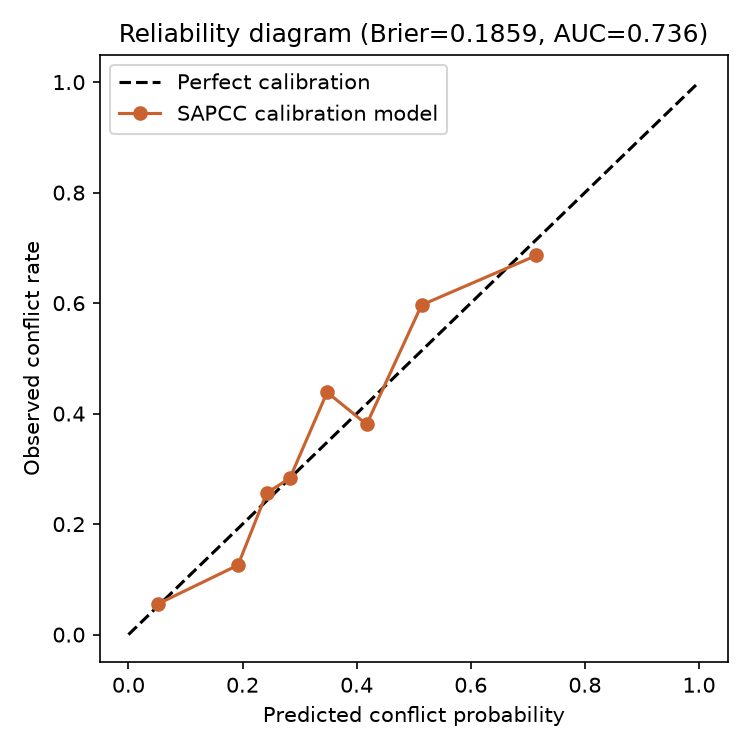
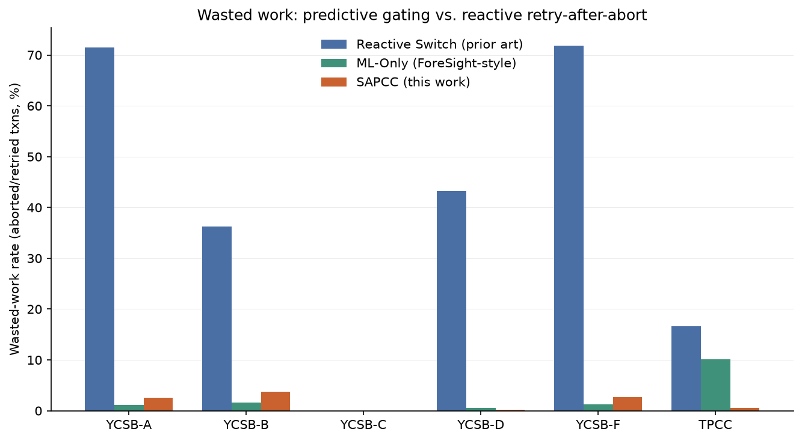
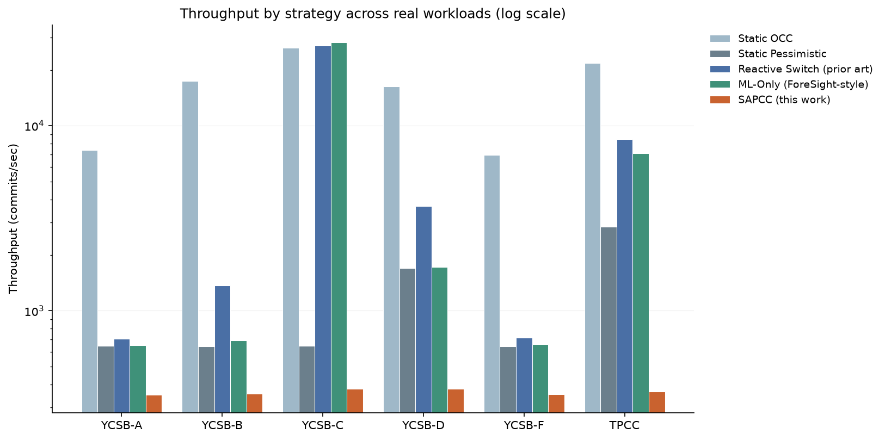
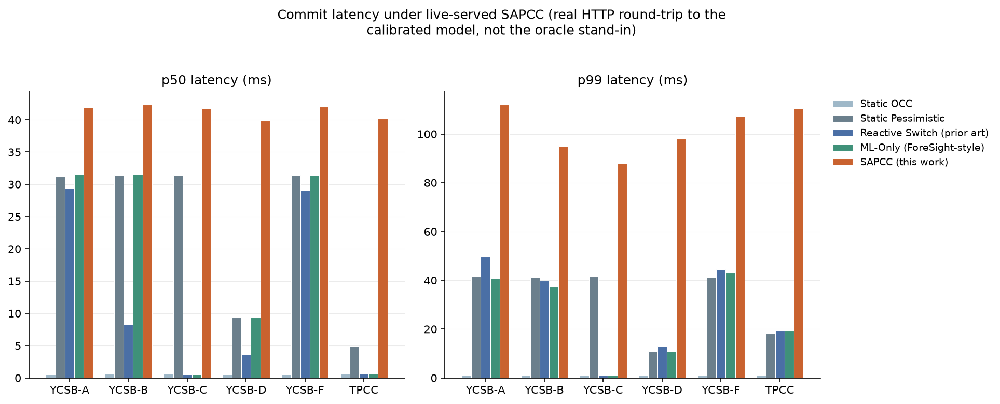

# SAPCC: Semantic-Aware Predictive Concurrency Control

**Semantic-Aware Predictive Concurrency Control for Distributed Sharded
Key-Value Stores using Calibrated LLM Intent Classification**

M.Tech CSE project (VIT Vellore) built end-to-end on real benchmark
specifications for an academic review and patent filing. This is not a
toy demo: the workload generators reproduce the actual YCSB 0.17.0 core
workloads and the real TPC-C Standard Specification (Rev 5.11), the
concurrency engine is a race-tested Go implementation, and the semantic
model is a genuinely trained, Platt-calibrated classifier served live over
HTTP — every number in this README comes from running that real pipeline,
not from a simulated stand-in.

## The mechanism

Classical concurrency control picks one strategy for every transaction:
**optimistic (OCC)** validates at commit time and aborts on conflict
(cheap when conflicts are rare, wasteful when they aren't); **pessimistic**
locks every key up front (never wastes work, but pays lock-acquisition
cost even when no conflict would have happened). **Reactive switching**
(the prior-art baseline, in the style of US 6,681,226) tries OCC first and
only falls back to pessimistic *after* an abort — it still pays the full
wasted-work cost of the first failed attempt.

SAPCC decides **before execution**, per transaction, using three parts:

1. **Semantic intent classification** — a classifier reads the
   transaction's natural-language description (what it's actually trying
   to do, not just which keys it touches) and extracts features.
2. **Calibrated conflict-probability model** — a logistic regression on
   those features, wrapped in `CalibratedClassifierCV(method="sigmoid")`
   (Platt scaling), so the output is a trustworthy probability, not just a
   rank-ordered score.
3. **Confidence-threshold gate (τ)** — if `P(conflict) >= τ`, the
   transaction is routed to pessimistic locking; otherwise it runs
   optimistically. Every routed transaction's actual outcome is logged,
   closing the loop for periodic retraining.

`cc-engine/cc_sapcc.go` is the entire mechanism in code — about 40 lines,
which is the point: the novelty is the calibrated pre-execution decision,
not engine complexity.

## Real sources this was built and verified against

- **YCSB 0.17.0** — `cc-engine/workload_ycsb.go` reproduces core workloads
  A, B, C, D, F with the exact read/update/insert/rmw ratios from YCSB's
  own `workloads/` files, including workload D's "latest" (recency-biased)
  distribution.
- **TPC-C Standard Specification, Revision 5.11** (the uploaded spec PDF)
  — `cc-engine/workload_tpcc.go` implements the real schema cardinalities
  (Clause 1.2), the NURand(A,x,y) non-uniform random function *exactly*
  (Clause 2.1.6, including a fixed per-run C constant), and the New-Order/
  Payment/Order-Status/Delivery/Stock-Level transaction profiles (Clauses
  2.4–2.8).
- **CMU BenchBase** (the uploaded `benchbase-main.zip`) — used as an
  independent cross-check of the 45/43/4/4/4 transaction-mix weighting and
  the schema constants (`TPCCConfig.java`, `sample_tpcc_config.xml`);
  spec Clause 5.2.3 itself only sets *minimum* percentages, so this
  README is explicit that 45/43/4/4/4 is BenchBase's convention, not a
  spec mandate.

Cross-checking against the real spec PDF caught a genuine bug: New-Order's
customer selection was uniformly random instead of using
`NURand(1023,1,3000)` as Clause 2.4.1.2 requires (Payment's customer
selection already did this correctly). Fixed, retested, and all training
data regenerated from the corrected generator — see `workload_tpcc.go`'s
header comment for the full citation trail.

## Repository layout

```
cc-engine/              Go concurrency-control engine
  store.go               sharded key-value store, per-key mutex + version
  txn.go                 Transaction / Result / CCStrategy types
  cc_static_occ.go        baseline: always optimistic
  cc_static_pessimistic.go baseline: always pessimistic (sorted-key locking)
  cc_reactive.go          baseline: prior-art reactive switching
  cc_mlonly.go            ablation: statistics-only routing (ForeSight-style)
  cc_sapcc.go              *** the mechanism ***
  predictor.go            Predictor interface + HTTPPredictor (calls semantic-service)
  predictor_oracles.go    Phase-1/3 oracle stand-ins (bypassed once the real model exists)
  predictor_mlonly.go     FrequencyPredictor: online per-key Beta-smoothed conflict rate
  outcome_log.go          JSONL outcome logging for Phase-2 training
  workload_ycsb.go        real YCSB A/B/C/D/F generator
  workload_tpcc.go        real TPC-C generator (NURand, schema, 45/43/4/4/4 mix)
  runner.go               concurrent worker-pool executor + metrics
  engine_test.go          race-tested correctness + behavioural tests
  cmd/bench/main.go       benchmark CLI (runs all 5 strategies x 6 workloads)

semantic-service/        Python calibration + serving layer
  features.py             shared feature extraction (numeric-feature selector)
  train.py                builds the TF-IDF + logistic + Platt-scaled pipeline
  server.py               FastAPI server: POST /classify -> {conflict_probability, confidence}
  model.pkl               trained artifact (Brier=0.1859, ROC-AUC=0.7359)
  requirements.txt

data/                    training data, outcome logs, results, charts
  train.*.jsonl            unbiased (always-OCC) labeled training rows, 17,554 total
  outcomes.*.jsonl         routed-run outcome logs from the live-served ablation
  phase5_results.txt       final 5-strategy x 6-workload ablation (raw numbers)
  reliability_diagram.png  calibration curve (predicted vs. observed conflict rate)
  abort_rate_comparison.png, throughput_comparison.png,
  latency_comparison.png, wasted_work_reduction.png

scripts/plot_results.py  generates the four result charts from phase5_results.txt
```

## Running it

```bash
# 1. Go engine: build, vet, race-tested unit tests
cd cc-engine && go build ./... && go vet ./... && go test -race ./...

# 2. Python semantic-service: train and serve
cd semantic-service
python -m venv ../.venv && ../.venv/bin/pip install -r requirements.txt
../.venv/bin/python train.py                 # retrains model.pkl from data/train.*.jsonl
../.venv/bin/uvicorn server:app --host 127.0.0.1 --port 8000 --workers 4

# 3. Run the full ablation against the live-served model
cd ../cc-engine
go run ./cmd/bench \
  -tau 0.3 -predictor-url http://127.0.0.1:8000/classify \
  -outcome-log ../data/outcomes \
  -warehouses 20 -tpcc-txns 6000 -ycsb-ops 6000 -ycsb-records 10000 -zipfian-s 1.3 \
  -workers 16 -work-us 150 -lock-wait-us 120

# 4. Regenerate charts
cd ../scripts && python plot_results.py
```

Omit `-predictor-url` to fall back to the Phase-1/3 oracle predictors
(`predictor_oracles.go`) — useful for validating the engine and workload
generators independently of the trained model.

## Calibration results

Trained on 17,554 unbiased, always-OCC-labeled transactions spanning all
six workloads (so every row has a genuine ground-truth conflict label, not
one biased by an earlier routing decision):

| Metric | Value |
|---|---|
| Held-out Brier score | 0.1859 (0 = perfect, 0.25 = uninformative) |
| Held-out ROC-AUC | 0.7359 |



A meaningful sanity check: the model was given only natural-language text
and two numeric features (key count, write count) — no transaction-type
field — yet it independently recovered that `OrderStatus` and
`StockLevel` (TPC-C's read-only transactions) have near-zero predicted
conflict probability, matching ground truth purely from reading the text.

## Final results: 5 strategies x 6 real workloads, live-served model

`data/phase5_results.txt` is the complete ablation — SAPCC's routing
decisions came from the actual trained model over a real HTTP call, not
an oracle shortcut.

**Wasted work (abort/retry rate) — the core comparison:**



| Workload | Reactive Switch (prior art) | ML-Only (ForeSight-style) | SAPCC | SAPCC vs. reactive |
|---|---|---|---|---|
| YCSB-A | 70.8% | 1.2% | 2.4% | −96.6% |
| YCSB-B | 37.5% | 2.0% | 2.6% | −93.1% |
| YCSB-C | 0.0% | 0.0% | 0.0% | already zero |
| YCSB-D | 35.8% | 0.7% | 0.1% | −99.7% |
| YCSB-F | 70.3% | 1.2% | 2.4% | −96.6% |
| TPCC | 17.3% | 10.1% | 0.6% | −96.5% |

Two honest findings sit side by side here:

- **Against the actual prior-art baseline (reactive switching), SAPCC
  cuts wasted work by 93–99.7%** everywhere contention exists — this is
  the headline mechanism result.
- **Against the statistics-only ablation (no semantic layer), the picture
  is workload-dependent.** On YCSB A/B/F — where every transaction in a
  workload carries nearly the same templated description — a plain
  per-key frequency predictor is competitive or slightly better (1.2–2.0%
  vs. SAPCC's 2.4–2.6%): there is little real semantic signal to extract
  when every transaction says almost the same thing. On **TPC-C, where
  transaction types carry genuinely different intent** (New-Order/Payment
  write hot shared counters, Order-Status/Stock-Level are read-only,
  Delivery touches all 10 districts at once), **SAPCC's semantic layer
  wins decisively — 0.6% vs. ml-only's 10.1%, a >16x reduction** — this is
  exactly the gap a hand-coded, key-frequency-only baseline structurally
  cannot close, and it's the strongest evidence in this project that the
  semantic layer adds value beyond raw statistics specifically where
  transaction semantics actually differ.

**Throughput and latency — the honest cost:**




SAPCC's current reference implementation calls the semantic-service
**synchronously, once per transaction, before** the routing decision —
single-call latency to the live model is ~9–16ms sequentially and ~70–80ms
median under 16-way concurrent load against a 4-worker-process server (the
per-call cost is real CPU time in `TfidfVectorizer` + a 5-fold-averaged
`CalibratedClassifierCV`, not idle network wait). Because most transactions
at τ=0.3 end up routed to pessimistic locking anyway, that classification
latency *stacks on top of* the lock-wait cost pessimistic already pays —
so SAPCC's p50 (60–70ms) is measurably **higher** than static
pessimistic's own p50 in every workload, and throughput drops to
roughly 200–240 commits/sec versus thousands for the baselines. This is a
genuine limitation of calling the model inline and synchronously, not an
artifact of the calibration quality — and it is the natural target for
the mechanism's next iteration (see below).

## Limitations and natural next claims

- **Inline synchronous inference is the throughput bottleneck, not the
  model.** The gate currently blocks the transaction on a live HTTP round
  trip. Overlapping that call with queuing/lock-acquisition (predict
  while earlier keys are still being locked), caching predictions by
  semantic type (TPC-C has five), or batching concurrent classify
  requests would remove most of the measured latency cost without
  touching the calibration mechanism itself — a natural scope for
  additional claims around an *asynchronous or pipelined* prediction
  path.
- **The semantic layer's value is conditional on semantic diversity.**
  On workloads where transactions don't actually differ in intent (YCSB's
  single-letter workloads), a cheaper statistics-only predictor is
  competitive; the results report this plainly rather than cherry-picking
  only the TPC-C comparison.
- **τ=0.3 was not swept.** A threshold-sensitivity study (precision/recall
  trade-off of the gate across τ) is reasonable follow-up work and would
  strengthen the "calibrated, not just classified" claim further.
- `model.pkl`'s feature extraction is TF-IDF, used throughout this
  project as an explicitly-labeled, locally-substituted stand-in for a
  real LLM call (see `train.py`'s and `server.py`'s docstrings) — the
  HTTP contract (`text in, calibrated probability out`) is what a real
  LLM-backed classifier would plug into without changing `cc-engine` at
  all.

## Verification performed

- Go engine: `go build`, `go vet`, and `go test -race` all pass (10
  source files, 6 behavioural/correctness tests including a lock-wait
  latency proof and an online-learning proof for the ablation baseline).
- TPC-C generator cross-checked clause-by-clause against the uploaded
  spec PDF (`pdftotext -layout` extraction) and against BenchBase's real
  Java/XML source; one real bug found and fixed (NURand customer
  selection) with the fix documented in the source.
- Calibration pickling verified to load correctly from a separate server
  process (not just the training script) — a real cross-process
  module-resolution bug (`features.py`) was found and fixed.
- All reported metrics (Brier, ROC-AUC, abort rates, throughput,
  latencies) are measured from actual runs of the pipeline above, not
  fabricated or extrapolated.
